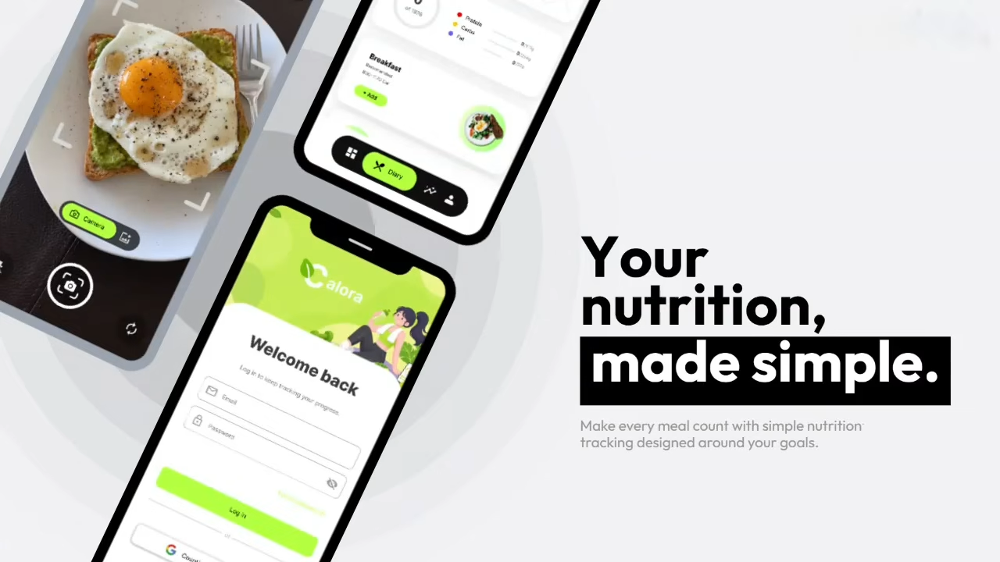
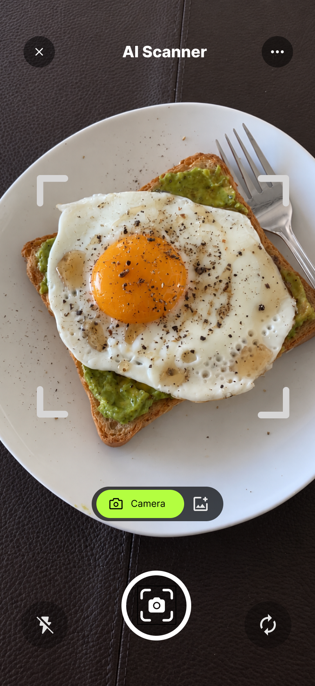
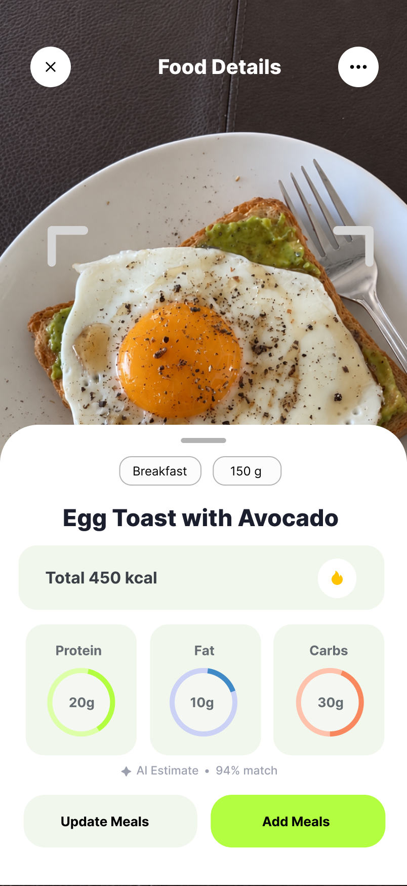
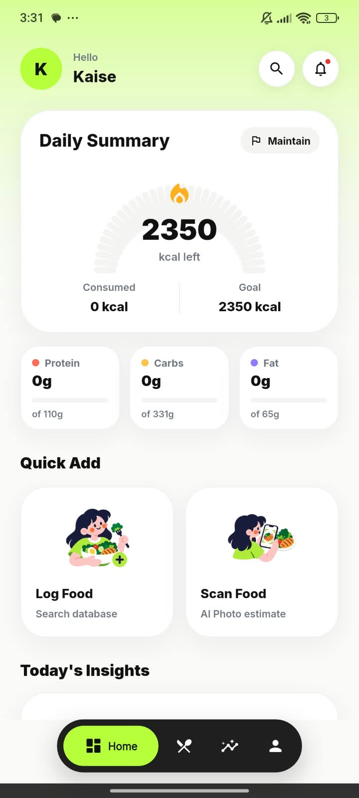
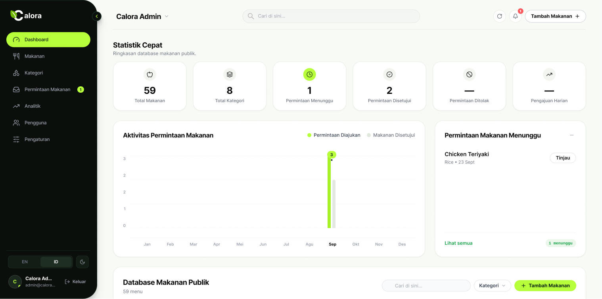
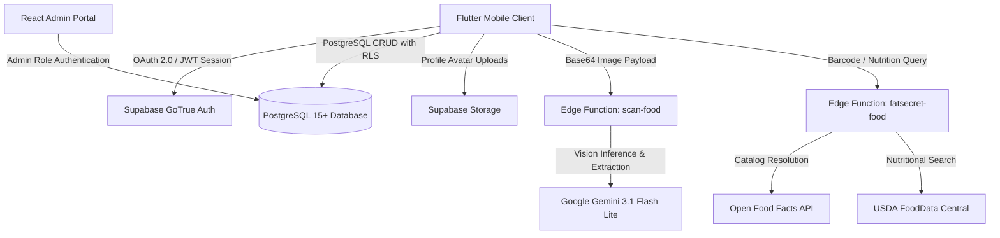

<p align="center">
  
</p>

# Calora - AI-Powered Nutrition and Calorie Intelligence Ecosystem

[](https://flutter.dev)
[](https://dart.dev)
[](https://supabase.com)
[](https://www.postgresql.org)
[](https://ai.google.dev)
[](https://react.dev)
[](https://opensource.org/licenses/MIT)

Cross-platform nutrition and metabolic health tracking ecosystem designed to eliminate dietary logging friction through multimodal computer vision and large language model inference. Architected with a feature-first Flutter client, a hardened serverless Supabase cloud backend, and a dedicated administrative moderation portal.

---

## Visual Showcase

| AI Food Scanner | Detection Result | Macro Dashboard | Admin Panel |
| :---: | :---: | :---: | :---: |
|  |  |  |  |

### Promotional Video

[](https://www.youtube.com/watch?v=f1Um_z3lmEw)

---

## Core Capabilities

- Multi-Modal Vision Processing: Integrates Google Gemini Vision models via authenticated Supabase Edge Functions (`scan-food`) to detect food items, infer portion estimates, and extract macro breakdowns from camera input with zero client credential exposure.
- Multi-Source Barcode Food Resolution: Cascading lookup pipeline querying the internal Calora food catalog, Open Food Facts REST API, USDA FoodData Central proxy, and an automated crowdsourced Food Request fallback.
- Nutrition Target Engine: Dynamically computes Basal Metabolic Rate (BMR) and Total Daily Energy Expenditure (TDEE) via the Mifflin-St Jeor formulation, tailoring caloric deficits, maintenance levels, or surplus splits based on user telemetry.
- Robust Authentication and Session Management: Complete GoTrue authentication suite supporting Email/Password, Google OAuth, and an in-app 6-digit OTP password recovery flow with neutral rate-limiting protection.
- Data Isolation via PostgreSQL RLS: Strict multi-tenant Row Level Security (RLS) policies enforcing cryptographic data isolation across user profiles, food diaries, weight logs, and food submissions.
- Administrative Web Console: Dedicated Vite and React management interface with Tailwind CSS for food catalog moderation, crowdsourced submission verification, and system log auditing.
- Offline-Tolerant State Management: Flutter Riverpod architecture with immutable state models and built-in local food dataset fallbacks ensuring uninterrupted tracking during network degradation.

---

## System Architecture



---

## Directory Structure

```plaintext
calora/
├── admin/                         # Administrative web console (Vite + React + TS)
│   ├── src/                       # Components, routing, Supabase integration
│   ├── screenshots/               # Interface records and visual audit captures
│   └── package.json               # Admin web dependencies
├── assets/                        # Static application assets and illustrations
│   └── translations/              # Localization dictionaries (en.json, id.json)
├── lib/
│   ├── core/                      # Global singletons, network, and design system
│   │   ├── config/                # SupabaseConfig and environment parameters
│   │   ├── services/              # AuthService, AiScannerService, BarcodeService, DiaryService
│   │   ├── theme/                 # AppColors, AppTypography, AppTheme
│   │   ├── utils/                 # NutritionCalculator, AgeCalculator, InputValidators
│   │   └── widgets/               # Reusable UI atoms (AppButton, AppTextField, MacroCard)
│   ├── features/                  # Domain modules partitioned by business capability
│   │   ├── auth/                  # Login, Register, and 6-digit OTP Forgot Password
│   │   ├── dashboard/             # Core tracking dashboard and macro progress rings
│   │   ├── diary/                 # Food diary, barcode scanner, and AI camera sheet
│   │   ├── insights/              # Weekly nutrition analytics and macro breakdown charts
│   │   ├── notifications/         # Notification management and provider state
│   │   ├── onboarding/            # Profile onboarding, goal roadmap, BMR/TDEE setup
│   │   ├── profile/               # Personal information, weight log journey, settings
│   │   └── splash/                # Startup routing and authentication verification
│   ├── models/                    # Immutable domain data models and DTO serializers
│   ├── routing/                   # Navigation shell and draggable pill controller
│   └── main.dart                  # Application bootstrap and initialization
└── supabase/
    ├── functions/                 # Deno serverless edge functions (scan-food, fatsecret-food)
    └── migrations/                # Version-controlled SQL schemas, RLS rules, and triggers
```

---

## Getting Started

### Prerequisites

- Flutter SDK (`>= 3.22.x`)
- Dart SDK (`>= 3.10.x`)
- Node.js (`>= 18.x`) with npm, yarn, or pnpm
- Supabase CLI

---

### 1. Backend and Serverless Edge Functions

Clone the repository:

```bash
git clone https://github.com/ananda6060galang-sys/calora.git
cd calora
```

Initialize or link your remote Supabase project:

```bash
# Link to remote Supabase project
supabase link --project-ref <YOUR_PROJECT_REF>

# Configure edge function secrets
supabase secrets set GEMINI_API_KEY=<YOUR_GEMINI_API_KEY>

# Apply database migrations and Row Level Security rules
supabase db push

# Deploy edge functions
supabase functions deploy scan-food
supabase functions deploy fatsecret-food
```

---

### 2. Flutter Mobile Application

Configure your Supabase endpoint and publishable key in [`lib/core/config/supabase_config.dart`](lib/core/config/supabase_config.dart):

```dart
class SupabaseConfig {
  SupabaseConfig._();

  static const String url = 'https://<YOUR_PROJECT_REF>.supabase.co';
  static const String publishableKey = '<YOUR_SUPABASE_ANON_OR_PUBLISHABLE_KEY>';
}
```

Install Flutter dependencies and launch the application:

```bash
flutter pub get
flutter run
```

---

### 3. Administrative Web Portal

Navigate to the `admin` directory and initialize environment variables:

```bash
cd admin
cp .env.example .env
```

Configure `VITE_SUPABASE_URL` and `VITE_SUPABASE_ANON_KEY` in `admin/.env`:

```env
VITE_SUPABASE_URL=https://<YOUR_PROJECT_REF>.supabase.co
VITE_SUPABASE_ANON_KEY=<YOUR_SUPABASE_ANON_OR_PUBLISHABLE_KEY>
```

Install node packages and start the development server:

```bash
npm install
npm run dev
```

---

## License

Distributed under the MIT License. See `LICENSE` for details.

---

## Author

**Ananda Galang Rezky Aditya**  
- GitHub: [@ananda6060galang-sys](https://github.com/ananda6060galang-sys)  
- Figma: [@anandagalangrez](https://figma.com/@anandagalangrez)  
- Email: ananda6060galang@gmail.com
